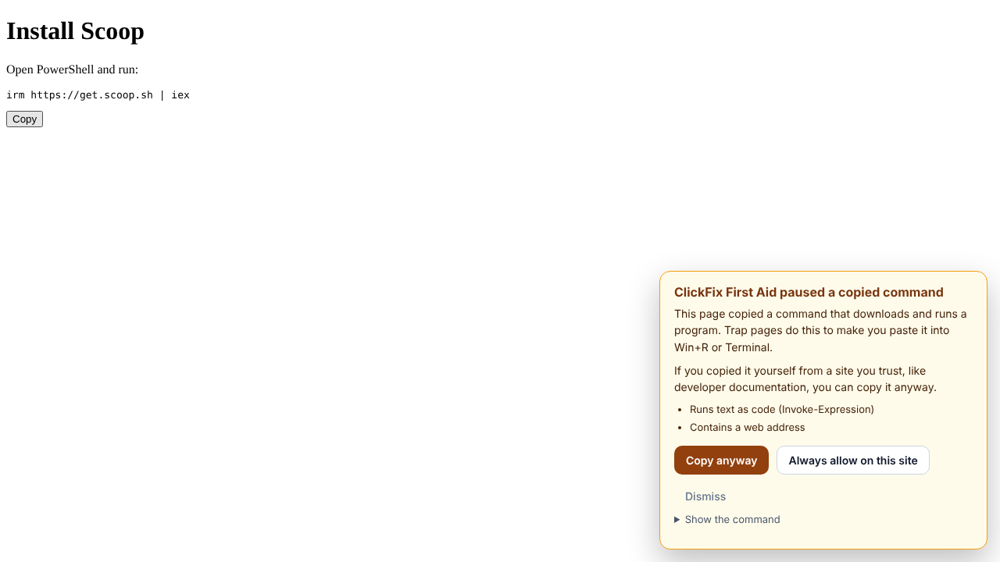
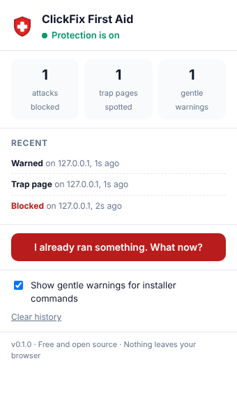

# ClickFix First Aid

**Free, open-source protection against ClickFix: the fake "I am not a robot" pages that trick you into installing malware yourself.**


A ClickFix page looks like a normal CAPTCHA or security check. When you tick the box, it secretly copies a command to your clipboard and tells you to:

1. Press **Windows + R**
2. Press **Ctrl + V**
3. Press **Enter**

That one paste downloads and runs malware, usually an *infostealer* that copies the logins saved in your browser. With those, criminals open your email, social media and chat accounts without needing your password or your phone.

ClickFix First Aid has three parts:

| | Part | What it does |
|---|---|---|
| **Stop it** | Browser extension (Chrome, Edge) | Catches the moment a page puts an attack command on your clipboard, swaps it for a harmless message, and shows a clear warning. Commands that download and run a program are paused so you can choose **Copy anyway**. Also flags pages whose text tells you to press Win+R and paste, and lets you check a command before you run it. |
| **Check it** | `Check-ClickFix.ps1` | A read-only Windows check of your Run box history, File Explorer address bar history, PowerShell history, new programs and startup items. |
| **Fix it** | [Recovery guide](guide/recovery.html) | The exact steps, in the right order, after you ran something: cut off stolen sign-ins from your phone first, then clean the PC. Bundled inside the extension so it works offline. |

When a page's code copies a command that downloads and runs a program (which is also how real installers look), it is paused instead, and you decide:



If a site asks you to run something, you can paste it into the extension's popup first and see what the rules say, without running it:



Plus an optional switch, `Protect-RunDialog.ps1`, that turns off the Win+R and Win+X shortcuts for people who never use them.

## Why this exists

ClickFix is one of the most common ways attackers get in today:

- Microsoft's Digital Defense Report 2025 found ClickFix behind **47% of initial-access incidents** its Defender Experts team handled over the year ([source](https://www.androidheadlines.com/2025/10/microsoft-warns-rising-clickfix-attacks-are-fooling-users-into-running-malware.html)).
- ReliaQuest attributed **nearly 28% of defense-evasion activity** to ClickFix between March and May 2026 ([source](https://www.darkreading.com/vulnerabilities-threats/winner-dominant-malware-delivery-clickfix)).
- Variants keep appearing: "FileFix" uses the File Explorer address bar instead of Win+R, and others target Mac Terminal ([Microsoft analysis](https://www.microsoft.com/en-us/security/blog/2025/08/21/think-before-you-clickfix-analyzing-the-clickfix-social-engineering-technique)).

This project started in October 2026, after a fake "I'm not a robot" page tricked its author. Everything here is built from that experience: what would have stopped it, what showed it had happened, and what actually worked to recover.

## Install

### Browser extension (Chrome or Edge)

Until it is published in the browser stores:

1. Download `clickfix-first-aid-extension-vX.Y.Z.zip` from the [latest release](../../releases/latest) and unzip it.
2. Open `chrome://extensions` (or `edge://extensions`) and turn on **Developer mode**.
3. Click **Load unpacked** and choose the unzipped folder.
4. Open the safe demo page (`docs/demo.html`, or the project website) and tick the box. You should see the red warning.

### PC check (Windows)

1. Download `Check-ClickFix.ps1` from the [latest release](../../releases/latest).
2. Right-click it and choose **Run with PowerShell**.

It reads only. It changes nothing and sends nothing anywhere. Exit code `0` means nothing found, `1` means items to review, `2` means signs of an attack. Use `-Json` for machine-readable output and `-Days 60` to look further back.

> **Never run this, or anything else, by pasting a command from a website.** That is exactly the trick this project protects you from.

### Optional: turn off Win+R

Run `Protect-RunDialog.ps1` the same way and pick option 1. It adds `R` and `X` to the `DisabledHotkeys` setting for your user and restarts File Explorer. Pick option 2 to undo. You can still open Run by typing "Run" in the Start menu.

## How it works

The short version (the long, beginner-friendly version is in [LEARN.md](LEARN.md)):

- **One set of rules, two engines.** [`rules/clickfix-rules.json`](rules/clickfix-rules.json) describes what an attack command looks like. The JavaScript engine ([`engine/detector.js`](engine/detector.js)) and the PowerShell checker use the same file, and the test suites check they agree on every shared sample.
- **Three verdicts.** *Block*: clearly an attack (fake "I am not a robot" text hidden after a command, heavy disguise, or any command on a page that says "verify you are human, press Win+R, paste"). The clipboard gets a harmless "STOP" message and a full warning. *Hold*: a command that downloads and runs a program, which is also how real installers look. When a page's own code copies one, the clipboard gets a harmless "PAUSED" message and you can choose **Copy anyway** or **Always allow on this site**. Copies you make by hand are not paused. *Allow*: everything else.
- **The extension guards all five ways a page can write to the clipboard** (`clipboard.writeText`, `clipboard.write`, `execCommand('copy')`, `clipboardData.setData` and `clipboardData.items.add`), from inside the page, before the page's own scripts run, with built-in functions captured so the page cannot tamper with the checks.
- **Warnings cannot be faked or silenced by the page.** The guard reports through a node inside a closed shadow root that the page cannot reach, and warnings are drawn in a closed shadow root the page cannot read or click.
- **It connects the dots.** A paused copy plus trap instructions anywhere in the tab, in any frame, before or shortly after the copy, becomes a full block warning. This survives Chrome stopping the extension's background worker, which it does after about 30 idle seconds.
- **Long text is never simply allowed.** Up to 200,000 characters are checked; anything longer is paused, so a command cannot hide behind a huge run of blank lines.
- **Check a command.** Paste a command into the popup to see what the rules say, without running it. "No known attack pattern" does not mean safe, and the popup says so.

## Privacy and permissions

- The extension asks for **storage** (its own counters and settings) and the ability to run on pages (needed to guard the clipboard). It has **no network access** and sends nothing anywhere; its own pages forbid network connections outright. Details in [PRIVACY.md](PRIVACY.md).
- `Check-ClickFix.ps1` is read-only. `Protect-RunDialog.ps1` changes one per-user setting and can undo it.

## Limitations (honest list)

- **Browser-side guards are a cat-and-mouse game.** A determined page may find new ways to reach the clipboard. A page can also see that the extension is there: the clipboard guard does not disguise itself, because hiding would be a malware-style trick. Seeing it does not get a page past the check. That is why the kit also has the Win+R switch and the PC check.
- **Detection is pattern-based.** New disguises may need new rules. Please report them (see [SECURITY.md](SECURITY.md)).
- **It cannot see what you type.** A page that only shows a command and asks you to type it by hand is caught only by the trap-page banner, and only if its wording matches.
- **Copying an attack sample from a security blog gets blocked too.** Click **Dismiss**. Articles that describe the attack ("press Win+R, paste", "I am not a robot") may also get the trap-page banner. Only this project's own website and README are exempt from the banner.
- **The Win+R switch only stops the Win+R / Win+X trick.** It does not stop someone typing "powershell" in the Start menu or pasting into the File Explorer address bar (FileFix). It uses the `DisabledHotkeys` setting, which is widely used but not formally documented by Microsoft.
- **The PC check is Windows-only for now,** and has not yet been run on many real PCs. Its tests run on PowerShell 7; CI also runs them on Windows PowerShell 5.1.
- **A trap that opens a new pop-up window** shows its warning in that window.
- **Huge pages make a command copy slower.** The page is read only when the copied text looks like a command. Measured in headless Chromium: about 10 to 30 ms extra on a page with 1,000 paragraphs, about 0.2 seconds on one with 100,000.

## Independent review

Version 0.1.0 was reviewed before release with Perplexity, which reported 11 bypasses, 7 false-positive problems, 4 UI issues, 7 PowerShell issues and 10 guide corrections, with harmless proof-of-concept pages. v0.2.0 fixes them. The proof-of-concept pages now run in the test suite on every change.

A second round (an architecture and risk analysis, a QA plan with contract tests, and a security and integration review) led to v0.3.0. Checking that round also turned up two problems nobody had reported: padding could hide a command past the 20,000-character limit, and four patterns could be made extremely slow. All reports are in [reviews/](reviews/), and [CHANGELOG.md](CHANGELOG.md) says what was fixed and what was not, and why.

## Development

```bash
npm ci               # exact tool versions from package-lock.json
npm run build        # regenerate generated files after editing rules, engine or guide
npm test             # engine and contract tests
npm run test:ps      # PowerShell checker tests (needs pwsh)
npm run test:e2e     # loads the extension into Chromium against fake trap pages (npx playwright install chromium first)
npm run package      # builds release files and SHA256SUMS.txt into dist/
npm run links        # checks the recovery guide's official help links
```

Current results: 80 engine and contract tests, 116 PowerShell tests and 52 browser tests. The fake trap pages are stored encoded (`node scripts/fixtures.mjs`), because antivirus programs quarantine them as real attack pages. Releases follow [RELEASING.md](RELEASING.md). All "malicious" test samples use reserved, non-routable hosts (`example.invalid`, `*.example`, `203.0.113.0/24`) and the fake trap pages only copy a harmless `echo` command.

Ideas and contributions are welcome, especially new attack samples, translations of the warnings, Firefox support and a Mac version of the checker. See [CONTRIBUTING.md](CONTRIBUTING.md).

## License

MIT. See [LICENSE](LICENSE).

Created by Vinay Kumar Mandadi, built with help.
