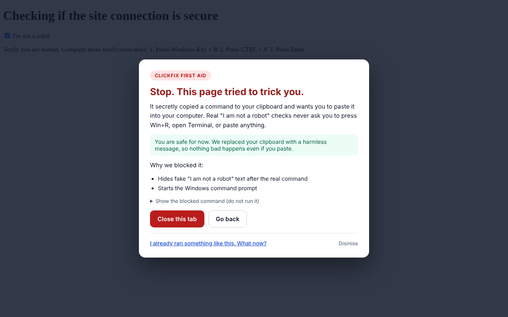

# ClickFix First Aid

**Free, open-source protection against ClickFix: the fake "I am not a robot" pages that trick you into installing malware yourself.**



A ClickFix page looks like a normal CAPTCHA or security check. When you tick the box, it secretly copies a command to your clipboard and tells you to:

1. Press **Windows + R**
2. Press **Ctrl + V**
3. Press **Enter**

That one paste downloads and runs malware, usually an *infostealer* that copies the logins saved in your browser. With those, criminals open your email, social media and chat accounts without needing your password or your phone.

ClickFix First Aid has three parts:

| | Part | What it does |
|---|---|---|
| **Stop it** | Browser extension (Chrome, Edge) | Catches the moment a page puts an attack command on your clipboard, swaps it for a harmless message, and shows a clear warning. Also flags pages whose text tells you to press Win+R and paste. |
| **Check it** | `Check-ClickFix.ps1` | A read-only Windows check of your Run box history, File Explorer address bar history, PowerShell history, new programs and startup items. |
| **Fix it** | [Recovery guide](guide/recovery.html) | The exact steps, in the right order, after you ran something: cut off stolen sign-ins from your phone first, then clean the PC. Bundled inside the extension so it works offline. |

Plus an optional switch, `Protect-RunDialog.ps1`, that turns off the Win+R and Win+X shortcuts for people who never use them.

## Why this exists

ClickFix is one of the most common ways attackers get in today:

- Microsoft's Digital Defense Report 2025 found ClickFix behind **47% of initial-access incidents** its Defender Experts team handled over the year ([source](https://www.androidheadlines.com/2025/10/microsoft-warns-rising-clickfix-attacks-are-fooling-users-into-running-malware.html)).
- ReliaQuest attributed **nearly 28% of defense-evasion activity** to ClickFix between March and May 2026 ([source](https://www.darkreading.com/vulnerabilities-threats/winner-dominant-malware-delivery-clickfix)).
- Variants keep appearing: "FileFix" uses the File Explorer address bar instead of Win+R, and others target Mac Terminal ([Microsoft analysis](https://www.microsoft.com/en-us/security/blog/2025/08/21/think-before-you-clickfix-analyzing-the-clickfix-social-engineering-technique)).

This project started after the author's own PC was infected by a ClickFix page inside a paid online task in October 2026. Within hours, stolen logins were used to take over social media and chat accounts. Everything here is built from that experience: what would have stopped it, what showed it had happened, and what actually worked to recover.

## Install

### Browser extension (Chrome or Edge)

Until it is published in the browser stores:

1. Download `clickfix-first-aid-extension-vX.Y.Z.zip` from the [latest release](../../releases/latest) and unzip it.
2. Open `chrome://extensions` (or `edge://extensions`) and turn on **Developer mode**.
3. Click **Load unpacked** and choose the unzipped folder.
4. Open the safe demo page (`docs/demo.html`, or the project website) and tick the box. You should see the red warning.

### PC check (Windows)

1. Download `Check-ClickFix.ps1` from the [latest release](../../releases/latest).
2. Right-click it and choose **Run with PowerShell**.

It reads only. It changes nothing and sends nothing anywhere. Exit code `0` means nothing found, `1` means items to review, `2` means signs of an attack. Use `-Json` for machine-readable output and `-Days 60` to look further back.

> **Never run this, or anything else, by pasting a command from a website.** That is exactly the trick this project protects you from.

### Optional: turn off Win+R

Run `Protect-RunDialog.ps1` the same way and pick option 1. It adds `R` and `X` to the `DisabledHotkeys` setting for your user and restarts File Explorer. Pick option 2 to undo. You can still open Run by typing "Run" in the Start menu.

## How it works

The short version (the long, beginner-friendly version is in [LEARN.md](LEARN.md)):

- **One set of rules, two engines.** [`rules/clickfix-rules.json`](rules/clickfix-rules.json) describes what an attack command looks like. The JavaScript engine ([`engine/detector.js`](engine/detector.js)) and the PowerShell checker use the same file, and the test suites check they agree on every shared sample.
- **Commands are judged on several signals:** does it start a program (PowerShell, cmd, mshta, msiexec...), does it reach the internet, is it encoded or disguised (hidden window, `^` tricks, Base64), and does it hide fake "I am not a robot" text after the real command. Developer one-liners like `irm https://get.scoop.sh | iex` only get a gentle note. Disguised ones, or any command on a page that says "Win+R, paste", get blocked.
- **The extension guards all four ways a page can write to the clipboard** (`clipboard.writeText`, `clipboard.write`, `execCommand('copy')` and `copy` events), from inside the page, before the page's own scripts run.
- **Warnings cannot be faked by the page.** The extension re-checks every report in its own isolated world, and draws its UI in a closed shadow root that the page cannot read or click.

## Privacy and permissions

- The extension asks for **storage** (its own counters) and the ability to run on pages (needed to guard the clipboard). It has **no network access** and sends nothing anywhere.
- `Check-ClickFix.ps1` is read-only. `Protect-RunDialog.ps1` changes one per-user setting and can undo it.

## Limitations (honest list)

- A determined page can sometimes slip past browser-side guards (for example by grabbing a fresh copy of the clipboard functions from a new frame before the extension loads there). That is why the kit also has the Win+R switch and the PC check.
- Detection is pattern-based. New disguises may need new rules. Please report them (see [SECURITY.md](SECURITY.md)).
- If you copy an attack sample by hand from a security blog, it gets blocked too. Click **Dismiss**.
- The PC check is Windows-only for now.

## Development

```bash
npm run build        # regenerate generated files after editing rules, engine or guide
npm test             # engine unit tests
npm run test:ps      # PowerShell checker tests (needs pwsh)
npm run test:e2e     # loads the extension into Chromium against fake trap pages (needs playwright)
npm run package      # builds release files into dist/
```

All "malicious" test samples use reserved, non-routable hosts (`example.invalid`, `*.example`, `203.0.113.0/24`) and the fake trap pages only copy a harmless `echo` command.

Ideas and contributions are welcome, especially new attack samples, translations of the warnings, Firefox support and a Mac version of the checker. See [CONTRIBUTING.md](CONTRIBUTING.md).

## License

MIT. See [LICENSE](LICENSE).

Created by Vinay Kumar Mandadi, built with help from Claude (Anthropic).
