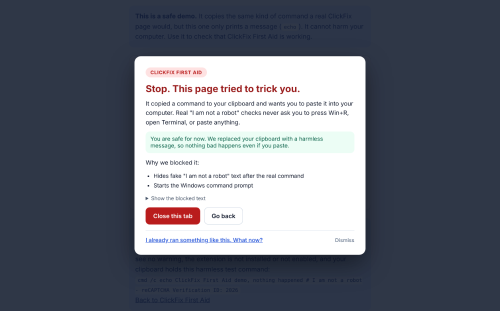
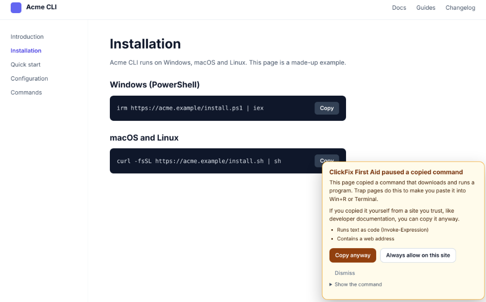
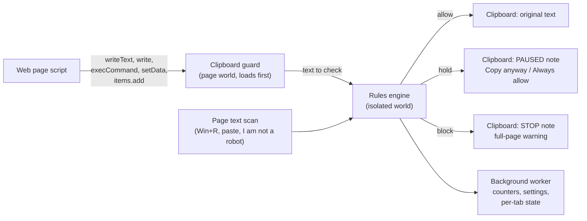

# ClickFix First Aid: Technical Report

**Architecture, privacy model and a measured evaluation against published ClickFix techniques**

| | |
|---|---|
| Document | CFA-TR-2026-01 |
| Version | 1.0 |
| Date | 6 November 2026 |
| Product version | ClickFix First Aid 0.3.3 |
| Author | Vinay Kumar Mandadi |
| Status | Public |
| Source | [github.com/vinaykumarchowdary18/clickfix-first-aid](https://github.com/vinaykumarchowdary18/clickfix-first-aid) |

---

## 1. Executive summary

ClickFix is a social engineering technique in which a web page shows a fake security check, silently puts a command on the visitor's clipboard, and tells the visitor to paste it into the Windows Run box, a terminal or File Explorer. The visitor then runs the attacker's command themselves. Microsoft's Digital Defense Report 2025 names ClickFix the most common initial access method that its Defender Experts observed in the last year, at 47% of attacks; the report covers Microsoft's fiscal year 2025 (July 2024 to June 2025) [1].

ClickFix First Aid is a free, open-source browser extension for Chromium-based browsers that stops the attack at the moment a page writes to the clipboard, before anything reaches the operating system. It is published on Microsoft Edge Add-ons [2] and also works in Google Chrome. A companion PowerShell script checks a Windows PC for signs of an earlier attack, and a built-in recovery guide walks people through what to do if they already ran a command.

This report describes how the extension works and how it treats user data, and measures it against 25 attack commands taken from public threat reports and technical write-ups published in 2025 and 2026. None of these commands was part of the project's own test suite when the measurement was made.

**Scorecard (ClickFix First Aid 0.3.3, measured 6 November 2026)**

| Measure | Result |
|---|---|
| Attacks stopped on fake verification pages | **25 of 25 (100%)** |
| Attacks stopped when the page gives no instructions (command alone) | **20 of 25 (80%): 12 blocked, 8 paused for confirmation** |
| Clipboard write methods covered | **5 of 5** |
| Plain commands copied unchanged (no false alarm) | **18 of 18 (100%)** |
| Download-and-run installers paused for one-click confirmation | **6 of 6** |
| Permissions requested | **1** (`storage`), plus content scripts on all pages |
| Network requests made by the extension | **None** |
| Automated tests passing | **248** (80 engine, 116 PowerShell, 52 browser end-to-end) |

Six other anti-ClickFix extensions whose code is public were run through the same test with their default settings (section 7). ClickFix First Aid was the only one to stop all 25 attacks on fake verification pages and the only one to stop the attack with all five clipboard write methods. When the page gave no instructions, ClickFix Mitigator stopped the most (22 of 25), ahead of ClickFix Guard by samdem-ai (21) and ClickFix First Aid (20); ClickFix Mitigator also blocked 7 of the 24 ordinary commands, including all six installer one-liners, while ClickFix First Aid paused those six for one-click confirmation and copied every plain command unchanged. Three of the six tools warn the user but leave the attack command on the clipboard. ClickFix Block by Eye Security, the most widely installed tool found, could not be tested because its code is not published and its store package could not be downloaded.

## 2. The threat

### 2.1 How a ClickFix attack works

1. The visitor reaches a page through a search result, an advertisement, a compromised legitimate website or a link in an email.
2. The page imitates a CAPTCHA, a Cloudflare check or an error message and asks the visitor to "verify you are human".
3. When the visitor clicks, the page's script writes a command to the clipboard. Nothing is downloaded at this point.
4. The page shows instructions such as *Press Windows + R, press Ctrl + V, press Enter*. Newer variants use Windows + X and Windows Terminal, the File Explorer address bar ("FileFix"), or the macOS Terminal.
5. The pasted command downloads and runs malware, most often an information stealer that copies saved passwords and browser session cookies.

Because the victim starts the program, the attack passes through email filters and download protection, and the first malicious process is a legitimate Windows tool such as PowerShell, `mshta`, `msiexec` or `rundll32`.

### 2.2 Scale

| Finding | Source |
|---|---|
| ClickFix was the most common initial access method that Microsoft Defender Experts observed in Defender Experts notifications in the last year, accounting for 47% of attacks. The report covers fiscal year 2025 (July 2024 to June 2025). | Microsoft Digital Defense Report 2025 [1] |
| ClickFix detections grew by more than 500% from the second half of 2024 to the first half of 2025, making it the second most common attack vector after phishing, with nearly 8% of all blocked attacks. | ESET Threat Report H1 2025 [3] |
| From March to May 2026, ClickFix led initial access in ReliaQuest's incident data (as Spearphishing Link, 14.9%), and the two obfuscation techniques that fingerprint it made up nearly 28% of defense-evasion activity. | ReliaQuest [4] |
| An analysis of about 3,000 live ClickFix payloads found PowerShell and `cmd` tied as the most common launchers at about 39% each, with `msiexec` close behind at 34%, with the lure moving from Windows + R to Windows + X and Windows Terminal. | Bert-Jan Pals, reported by The Hacker News [5] |

### 2.3 How the technique keeps changing

Public reports from 2025 and 2026 describe a steady stream of new command shapes: commands launched through `pcalua`, `forfiles` and headless `conhost`; payloads fetched with `finger` or hidden in DNS answers retrieved with `nslookup`; `rundll32` loading a file by ordinal from a WebDAV share; keywords split into variables or broken up with `^` characters; commands padded with spaces so that only a harmless-looking label is visible; and Base64-encoded one-liners for macOS Terminal [6][7][8][9]. A defence that looks for a fixed list of words falls behind quickly, which is why this project combines command analysis with the context of the page (section 4).

## 3. Product overview

| Part | What it does |
|---|---|
| **Browser extension** (Chrome, Edge and other Chromium browsers) | Checks every attempt by a web page to write to the clipboard. Attack commands are replaced with a harmless message and a full-page warning. Commands that download and run a program, which is also how genuine installers look, are paused so the user can choose **Copy anyway**. Pages that tell the visitor to press Win+R and paste get a warning banner. A popup lets the user paste a command and see what the rules say about it, without running it. |
| **PC check** (`Check-ClickFix.ps1`) | A read-only Windows script that looks at the Run box history, File Explorer address bar history, PowerShell history, recently added programs and startup items for signs of an attack. |
| **Win+R switch** (`Protect-RunDialog.ps1`) | An optional, reversible setting that turns off the Windows + R and Windows + X shortcuts for people who never use them. |
| **Recovery guide** | Step-by-step instructions for people who already ran a command: cut off stolen sign-ins from a clean device first, then clean the PC. It is bundled inside the extension so it works offline, and every menu path links to the vendor's own help page. |

All four parts are released together under the MIT License, with SHA-256 checksums for every file.

<p class="shots"> </p>

*Figure 1. Left: a fake verification page put an attack command on the clipboard; the extension replaced it with a harmless message and explains what happened. Right: a documentation page's Copy button placed a download-and-run installer on the clipboard; one click on Copy anyway copies it as normal.*

## 4. How the extension works



### 4.1 Where it intercepts

A web page can write to the clipboard in five ways: `navigator.clipboard.writeText`, `navigator.clipboard.write`, `document.execCommand('copy')`, and, inside a copy event, `clipboardData.setData` and `clipboardData.items.add`. The extension's guard runs in the page's own JavaScript world at `document_start`, in every frame, before any page script, and wraps all five. It captures the built-in functions it relies on before the page can replace them, so a page cannot switch the check off by tampering with JavaScript built-ins. Copies the user makes by hand (Ctrl + C, right-click) are not paused.

### 4.2 How it decides

One set of rules (`rules/clickfix-rules.json`) describes what an attack command looks like. The JavaScript engine in the extension and the PowerShell checker read the same file, and the test suites check that both reach the same verdict on every shared sample. Before matching, the engine undoes common disguises: it removes caret and backtick escapes, joins strings split with quotes and plus signs, and treats Unicode dashes and curly quotes as their plain forms. It counts only lines that actually do something, so padding a command with spaces or comment lines does not make it look harmless. Text up to 200,000 characters is analysed; anything longer is paused rather than allowed.

Every write gets one of three verdicts:

| Verdict | When | What happens |
|---|---|---|
| **Block** | Clearly an attack: heavy disguise, a fake "I am not a robot" comment after a command, a known attack tool chain, or any command copied on a page that tells the visitor to press Win+R and paste. | The clipboard receives a harmless `# STOP` message and the page is covered by a warning that explains what happened. |
| **Hold** | The command downloads and runs a program. Attackers and genuine installers both look like this. | When a page's own script copies it, the clipboard receives a harmless `# PAUSED` message and the user can choose **Copy anyway** or **Always allow on this site**. |
| **Allow** | Everything else. | Nothing changes. |

### 4.3 Using the page as evidence

ClickFix pages need the visitor to follow instructions, so the instructions themselves are a strong signal. The extension reads the visible text of the page and of every frame, including text that appears after the click, and recognises instructions to press Windows + R or Windows + X, to open a terminal or the File Explorer address bar, to paste, and to "verify you are human". Keyboard instructions are recognised even when the surrounding text is in another language (a Spanish lure is part of the tests). A paused copy plus trap instructions anywhere in the tab, before or shortly after the copy, becomes a block. This correlation survives the browser stopping the extension's background worker, which Chrome does after about 30 idle seconds, because the per-tab state is kept in `chrome.storage.session`.

### 4.4 Resistance to tampering

The guard reports to the isolated content script through a node inside a closed shadow root that page scripts cannot reach. Warnings are drawn inside a closed shadow root, so the page cannot read, restyle or click them. The guard does not try to disguise itself from the page: hiding an extension is a technique associated with malware, and a page that detects the guard is still blocked.

## 5. Security and privacy model

| Aspect | Design |
|---|---|
| Permissions | `storage` only. Content scripts run on all pages because ClickFix pages can be any website, including compromised legitimate ones. |
| Network access | None. The extension makes no network requests, and its own pages forbid network connections through their Content Security Policy (`connect-src 'none'`). |
| Remote code | None. All code ships in the package. |
| Data kept | Counters, the last 20 warnings (kind, site name, a short preview of the blocked or paused text with links broken), the user's settings and the sites the user allowed, in the browser's local extension storage. **Clear history** deletes the history and counters; removing the extension deletes everything. For each open tab, whether it showed trap instructions and, for a paused copy, the reason and a short preview (up to 600 characters, links broken), kept in memory only (`chrome.storage.session`) and cleared when the tab closes or reloads and when the browser closes. |
| Data sent anywhere | Nothing. There is no server, no account, no analytics and no telemetry. |
| Page text | Read locally to recognise trap instructions. It is never stored or sent. |

The full privacy statement is in `PRIVACY.md` in the repository, and the Microsoft Edge Add-ons listing links to it.

## 6. Evaluation

### 6.1 Method

**Attack corpus.** 25 attack commands, each taken from a public threat report or technical write-up published in 2025 or 2026 (Appendix A). Every command was defanged: host names were replaced with reserved names (`example.invalid`) or documentation addresses (`203.0.113.0/24`), and encoded payloads decode to harmless text or to commands that point only at reserved addresses. Where a report published the full command, its shape was kept as published (20 samples, marked V). Where the report truncated the command, the tail was completed (1 sample, V+). Where a report described a command without printing it, the command was reconstructed from the description (4 samples, R). The corpus covers Windows (21 samples) and macOS (4 samples).

**Held out.** None of these 25 commands was in the project's test suite when they were measured, and the detection rules were not changed after seeing the results. The results below are therefore what version 0.3.3, as published, does with commands it was not tuned on.

**Ordinary commands.** 24 commands that people copy from documentation every day (Appendix B): 18 plain commands, such as `winget install`, `git clone` or `docker compose up`, and 6 official installer one-liners that download and run a script, such as the Bun, Deno, nvm and PowerShell 7 installers.

**Scenarios.**

| Scenario | Page | Copy method | Cases |
|---|---|---|---|
| Attack on a fake verification page | An "I'm not a robot" check that reveals Win+R (or Terminal) instructions when clicked | `navigator.clipboard.writeText` | 25 |
| Attack without instructions | A plain documentation-style page with a Copy button; nothing tells the visitor to paste anywhere | `navigator.clipboard.writeText` | 25 |
| Clipboard write methods | Fake verification page, one encoded PowerShell command (H17) | All five methods | 5 |
| Ordinary copy button | Documentation-style page with a Copy button | `navigator.clipboard.writeText` | 24 |

**Measurement.** Each extension was loaded on its own into Chromium 141.0.7390.37 (Playwright, new headless mode). For each case the harness put a marker on the clipboard, opened the page, waited 1 second (as a person reading the page would), clicked, waited 5 seconds, and read the clipboard. The outcome is *delivered* if the clipboard holds exactly the text the page tried to copy, and *stopped* otherwise (the copy was prevented, or the clipboard holds a warning instead). For an attack, delivered means the attack got through. For an ordinary command, anything other than delivered is a false alarm or added friction. Pages were served from the local machine under made-up host names, so extensions treated them as ordinary websites, and no traffic left the machine. A control run with no extension loaded confirmed that all 79 cases reach the clipboard when nothing intervenes.

The harness and the encoded corpus are in the repository (`benchmark/`), so the measurement can be repeated (Appendix C). The full per-case results and screenshots of every tool on the same cases are in `benchmark/results/2026-11-06/`.

### 6.2 Results for ClickFix First Aid 0.3.3

| Scenario | Stopped | Delivered |
|---|---|---|
| Attack on a fake verification page | 25 of 25 (100%): 25 blocked | 0 |
| Attack without instructions | 20 of 25 (80%): 12 blocked, 8 paused | 5 |
| Clipboard write methods | 5 of 5 (100%): 5 blocked | 0 |

| Ordinary commands | Copied unchanged | Paused (one click to copy) | Blocked |
|---|---|---|---|
| Plain commands (18) | 18 | 0 | 0 |
| Installer one-liners (6) | 0 | 6 | 0 |

**Reading the results.**

- **On a fake verification page, every attack was stopped.** The trap instructions on the page turn any command into a block, so this score depends on the page scan as much as on the command rules.
- **Without instructions, 20 of 25 commands were still stopped by the command rules alone.** 12 were blocked outright. 8 were paused, because without instructions on the page a download-and-run command looks the same as a genuine installer; the user sees what the command does and has to click **Copy anyway** to continue. The five that got through are listed in section 8 as rule work for the next version.
- **No ordinary command was blocked.** The six installer one-liners were paused, as designed: a copy button that silently places a download-and-run command on the clipboard is exactly what a ClickFix page does, so the user is asked to confirm with one click. Commands the user selects and copies by hand are never paused.

Per-sample results are in Appendix A.

### 6.3 Development test suite

| Suite | Tests | What it covers |
|---|---|---|
| Engine and contract tests (`npm test`) | 80 | 26 attack shapes blocked, 21 ordinary texts allowed, 11 installers held, page detection in several phrasings and languages, frames, tampering, long-text padding, pattern speed, and 7 contract cases from an external QA plan produced with AI models (Perplexity; see section 9). |
| PowerShell checker tests (`npm run test:ps`) | 116 | The PowerShell checker reaches the same verdict as the JavaScript engine on all 58 shared samples; whole-PC analysis with fake evidence; the Win+R switch; every script parses and is pure ASCII. |
| Browser end-to-end tests (`npm run test:e2e`) | 52 | The real extension in Chromium: all five copy methods, frames, late or hidden instructions, Copy anyway, Always allow, hand copies, a page hijacking a hand copy, the background worker being stopped mid-attack, the popup, the no-network rule, and 24 proof-of-concept bypass pages from the same AI-produced external security review. |

Continuous integration runs on every change: the engine, PowerShell and browser suites on Linux with Node.js 22 and 24, the checker on Windows PowerShell 5.1, a dependency audit, a check that generated files are current, and a Microsoft Defender scan of the repository. All jobs passed on the latest commit of the main branch.

### 6.4 Performance

The page text is read only when the copied text looks like a command. Measured in headless Chromium during development (version 0.3.0), this adds about 10 to 30 ms to a command copy on a page with 1,000 paragraphs, and about 0.2 seconds on a page with 100,000 paragraphs. Ordinary copies are not slowed down.

## 7. Comparison with other tools

### 7.1 Landscape

These are the browser extensions built specifically against ClickFix that web searches of the Chrome Web Store, Firefox Add-ons and GitHub found in November 2026. Facts come from each tool's store listing, documentation or source code, as cited; user counts marked as third-party come from extension trackers, because the Chrome Web Store could not be read directly.

**Who makes them and where to get them**

| Tool | Maker | Where available | Source and license |
|---|---|---|---|
| **ClickFix First Aid** | Vinay Kumar Mandadi | Microsoft Edge Add-ons [2]; Chrome and other Chromium browsers from the release package | Open source, MIT |
| ClickFix Block | Eye Security | Chrome Web Store; about 60,000 users according to a third-party tracker [14] | Source not published [13] |
| ClickFix Mitigator | j0rd1s3rr4n0 (Jordi Serrano) | Firefox Add-ons (1 user) [16]; Chrome Web Store (24 users according to a third-party tracker) [17]; GitHub [24] | Open source, MIT [24] |
| ClickFix Warden | xVoidByte | GitHub only, no store listing yet [18] | Open source, MIT |
| ClickFix Guard | samdem-ai | GitHub, with a signed Firefox package [19] | Open source, MIT |
| ClickFix Guard | frameman | GitHub only [21] | Code public; no license stated |
| ClickFix Guard | samurayski | GitHub only [22] | Open source, MIT |
| StopFix | naxonez | GitHub only; last change October 2025 [20] | Open source, MIT (per its README) |
| BLANK | athx1337 | GitHub only [23] | Open source, MIT |

Three unrelated projects use the name "ClickFix Guard"; they are told apart here by their GitHub owners.

**How they work**

| Tool | Approach | Network use | Permissions |
|---|---|---|---|
| **ClickFix First Aid** | Wraps all five clipboard write methods before page scripts run; command rules plus a scan for trap instructions in every frame; block, pause or allow; recovery guide and Windows PC check | None | `storage`; content scripts on all pages |
| ClickFix Block | According to the vendor's technical write-up: wraps `document.execCommand` for copy and cut, matches keywords such as cmd, msiexec, powershell, iex, mshta, "not a robot" and captcha, and stops the copy with an alert; optional mode that blocks all scripted copies [13] | None described | `activeTab`, `storage` according to a third-party tracker [15]; content scripts on web pages |
| ClickFix Mitigator | A page script scores commands written to the clipboard and blocks risky ones; a setting to block every copy made by a page script, on by default; analyses page instructions; can block pages; part of a larger platform with an analyst dashboard [24] | By default sends a report of each alert (page address, detected text and page context) to the developer's server, and downloads block lists, allow lists and scoring settings from it; screenshots only if the user opts in [24]. The Firefox listing declares collection of website activity and website content [16] | `storage`, `tabs`, `notifications`, `clipboardRead`, `clipboardWrite`, `alarms`, `management`, `downloads`, `declarativeNetRequest`, `contextMenus`, all websites and local files [24] |
| ClickFix Warden | Wraps clipboard writes, including copies through a fresh iframe; scoring engine with de-obfuscation; checks sites and downloads against reputation feeds built from abuse.ch data [18] | Downloads signed rule and reputation feeds every hour from GitHub Pages [18] | `storage`, `unlimitedStorage`, `alarms`, `webNavigation`, `webRequest`, `clipboardWrite`, all websites; optional `history`, `management` |
| ClickFix Guard (samdem-ai) | Page hook; rules, a shell parser and an on-device logistic-regression classifier; replaces blocked commands with a note [19] | None, according to its README [19] | `storage`, `clipboardWrite`, `offscreen`; content scripts on all pages |
| ClickFix Guard (frameman) | Wraps `writeText`, `write`, `execCommand` and `setData`; decodes layered encodings; also watches page network calls; full-screen warning for high risk [21] | None described | `clipboardWrite`, `storage`, all HTTP and HTTPS sites |
| ClickFix Guard (samurayski) | Clipboard hooks plus scoring of page text; shows a warning banner; managed policies for organisations [22] | Optional webhook set by an administrator, which can include the user's email address [22] | `storage`, `identity`, `identity.email`, all websites |
| StopFix | Flags PowerShell, mshta, msiexec, rundll32, regsvr32, bash and curl in clipboard writes; a dialog in Spanish asks the user to ignore it (**Ignorar**) or clear the clipboard (**Limpiar clipboard**) [20] | None described | `scripting`, `activeTab`, `storage`, all websites |
| BLANK | Scans a page on demand from the toolbar popup, or after page load on sites the user enables, with rules and an on-device classifier; can audit and wipe the clipboard; does not intercept clipboard writes [23] | Optional cloud second opinion with the user's own Groq or Google Gemini key [23] | `activeTab`, `scripting`, `storage`, `offscreen`, `clipboardRead` |

### 7.2 Head-to-head results

Every tool whose code is published and that intercepts clipboard writes automatically was run through exactly the same harness, corpus and Chromium build as ClickFix First Aid (section 6.1). Each was tested at the commit shown in Appendix C.

| Tool | Attacks stopped, fake verification page | Attacks stopped, no instructions | Copy methods covered | Ordinary commands copied unchanged | of which installers |
|---|---|---|---|---|---|
| **ClickFix First Aid 0.3.3** | **25 of 25 (100%)** | **20 of 25 (80%)** | **5 of 5** | **18 of 24** | **0 of 6** |
| ClickFix Guard 1.0.1 (samdem-ai) | 24 of 25 (96%) | 21 of 25 (84%) | 4 of 5 | 24 of 24 | 6 of 6 |
| ClickFix Warden 0.1.1 (xVoidByte) | 23 of 25 (92%) | 8 of 25 (32%) | 4 of 5 | 24 of 24 | 6 of 6 |
| ClickFix Mitigator 0.4.10 (j0rd1s3rr4n0) | 22 of 25 (88%) | 22 of 25 (88%) | 3 of 5 | 17 of 24 | 0 of 6 |
| ClickFix Mitigator 0.4.10, "Block all JavaScript clipboard copying" switched off | 0 of 25 (0%) | 0 of 25 (0%) | 1 of 5 | 24 of 24 | 6 of 6 |
| ClickFix Guard 2.0.0 (frameman) | 0 of 25 (0%) | 0 of 25 (0%) | 0 of 5 | 24 of 24 | 6 of 6 |
| ClickFix Guard 0.4.4 (samurayski) | 0 of 25 (0%) | 0 of 25 (0%) | 0 of 5 | 24 of 24 | 6 of 6 |
| StopFix 1.0 (naxonez) | 0 of 25 (0%) | 0 of 25 (0%) | 1 of 5 | 24 of 24 | 6 of 6 |

"Stopped" means the attack text did not reach the clipboard. For ClickFix First Aid it includes commands paused for confirmation (all of its stops on the fake verification page were blocks). "Ordinary commands copied unchanged" counts the 24 documentation commands that reached the clipboard exactly as copied; the last column shows how many of the 6 official installer one-liners among them did.

**What the numbers show**

- **Fake verification pages.** ClickFix First Aid stopped all 25 attacks, ClickFix Guard (samdem-ai) 24, ClickFix Warden 23 and ClickFix Mitigator 22. They missed different commands: ClickFix Guard (samdem-ai) missed H08 (a `cmd` line that assembles `pushd` and `rundll32` from variables to load a file from a WebDAV share), ClickFix Warden missed H06 and H08, and ClickFix Mitigator missed H02, H04 and H24 (two commands broken up with `^` characters, and a short `iex (irm …)` PowerShell command that downloads and runs a script). ClickFix First Aid stopped all of them because, on a page with trap instructions, it blocks any command that is copied (section 4.3).
- **No instructions on the page.** ClickFix Mitigator stopped 22 of 25, ClickFix Guard (samdem-ai) 21, ClickFix First Aid 20 (12 blocked, 8 paused for confirmation) and ClickFix Warden 8. ClickFix First Aid missed H06, H08, H13, H18 and H19; ClickFix Guard (samdem-ai) missed H05, H07, H08 and H19; ClickFix Mitigator missed H02, H04 and H24. H08 and H19 were stopped only by ClickFix Mitigator.
- **Clipboard write methods.** Only ClickFix First Aid stopped the attack with all five methods. ClickFix Guard (samdem-ai) and ClickFix Warden let it through when the page wrote it with `clipboardData.items.add` inside a copy event; ClickFix Mitigator let it through with `navigator.clipboard.write` and with `clipboardData.items.add`. StopFix stopped only the `document.execCommand('copy')` case.
- **Ordinary commands.** ClickFix Mitigator blocked 7 of the 24 ordinary commands: all six installer one-liners and `oh-my-posh init pwsh | Invoke-Expression`. Its on-page notice has only a **Close** button and offers no way to copy the command anyway; allow and block lists are managed in the extension's own settings [24]. ClickFix First Aid paused the six installer one-liners and copied each with one click on **Copy anyway**. The other tools copied all 24 unchanged.
- **ClickFix Mitigator settings.** Its setting "Block all JavaScript clipboard copying" is on by default [24], but ordinary commands were still copied, so blocking of every page copy did not take effect in this test. With the setting switched off, the extension does not load its page script, and none of the 50 attacks written with `navigator.clipboard.writeText` was stopped (second Mitigator row).
- **Warn-only designs.** Three tools warn but leave the command on the clipboard, so a visitor who pastes anyway still runs it, and the harness counts the attack as delivered. ClickFix Guard (frameman) replaced the page with a full-screen "ClickFix scam blocked" warning in 23 of the 30 cases on fake verification pages, and did not replace any documentation page. ClickFix Guard (samurayski) showed a warning banner. StopFix showed a dialog in Spanish with **Ignorar** (ignore) and **Limpiar clipboard** (clear clipboard) buttons; the command stays on the clipboard unless the user clicks the second button. Screenshots of every tool on the same three cases are published with the results.
- **Timing.** A first run clicked as soon as each page had loaded. Two tools behaved differently in that run: ClickFix Mitigator, which starts checking a moment after a page loads, stopped 17 and 1 of 25 attacks instead of 22 and 22, and ClickFix Guard (frameman) showed its warning in all 30 cases. The results above come from the final run, in which the harness waited one second before each click, as a person reading the page would. The results of the other tools were the same in both runs. Both runs are published.

### 7.3 Tools not tested

- **ClickFix Block** (Eye Security) is the most widely installed of the tools found, but its code is not published and its store package could not be downloaded in the test environment, so it could not be loaded in the same harness. Its approach is described from the vendor's own technical write-up [13], which dates from October 2025; the current version may work differently. Based on that write-up, it intercepts `document.execCommand` copies, the method used by one of the five cases in the method test, and matches a short keyword list.
- **BLANK** scans a page on demand from its popup, or after page load on sites the user enables, and does not intercept clipboard writes as they happen [23]. The automated harness measures automatic interception of clipboard writes, so it does not apply.

### 7.4 Fairness notes

- The corpus was assembled by this project's author. It is built from other people's published reports and was not used for development, but other authors might choose different samples.
- Tools differ in intent. Some are designed to warn and leave the clipboard alone; the harness measures only whether the attack text reached the clipboard, so a warn-only design scores low here even if its warning is clear. These cases are marked in the notes.
- The tests ran with no internet access. Tools that download reputation feeds, rules or scoring settings (ClickFix Warden, ClickFix Mitigator) ran with what is bundled in their package only.
- Every tool ran with its default settings. ClickFix Mitigator was also run with its "Block all JavaScript clipboard copying" setting switched off, to show how much of its protection depends on that setting.
- The harness waits one second between a page loading and the click. Clicking at once disadvantaged one tool that starts checking a moment after the page loads (timing note in section 7.2).
- Results reflect the tested versions on 6 November 2026. All of these projects are changing quickly.

## 8. Limitations and next steps

**Known limitations of version 0.3.3**

- **Browser-side protection is a contest.** A determined page may find new ways to reach the clipboard or to word its instructions. That is why the project also ships the Win+R switch and the PC check.
- **Detection is pattern-based.** In this evaluation, five commands copied without trap instructions got through: H06 (curl download, tar extract and run, on three lines); H08 (cmd assembling pushd and rundll32 from variables); H13 (JackFix: XOR-decoded PowerShell); H18 (DNS variant: nslookup answer run by hidden PowerShell); H19 (DNS variant: nslookup beacon with user name). On a page with ClickFix instructions all five were blocked.
- **Typed commands are not seen.** A page that shows a command as an image and asks the visitor to type it is caught only by the instruction banner, and only if its wording is recognised.
- **Installers are paused.** Copy buttons for genuine download-and-run installers need one extra click. This is deliberate and can be switched off per site with **Always allow**.
- **The PC check is Windows-only.**

**Next steps**

1. Rules for the five missed command shapes, added as test samples with the same held-out discipline for future measurements.
2. A Chrome Web Store listing (the extension already runs in Chrome from the release package).
3. Firefox support.
4. Translations of the warnings and the recovery guide, starting with Hindi and Telugu.
5. A macOS version of the PC check.

## 9. Assurance and release engineering

- **Open source.** All code, rules, tests and documentation are public under the MIT License.
- **Store review.** Version 0.3.3 was published on Microsoft Edge Add-ons on 28 October 2026 after passing Microsoft's certification review. Store review checks policy compliance and safety; it is not a test of detection quality.
- **Reproducible releases.** Release packages are built by GitHub Actions from commits signed by GitHub, and each release lists SHA-256 checksums. The 0.3.3 package built in CI is byte-identical to a local build.
- **Repository protection.** The main branch cannot be deleted or force-pushed. Dependabot watches dependencies.
- **External review.** Two rounds of external review were produced with AI models (Perplexity) at the author's request: a security review of version 0.1.0 with proof-of-concept bypass pages, then an architecture and risk analysis, a QA plan with contract tests, and a security and integration review. Every finding was checked before acting on it. All four reports are published in `reviews/`, and the 24 proof-of-concept pages run in the browser tests on every change.
- **Safe test data.** Attack samples use reserved hosts and harmless payloads, and are stored Base64-encoded so that antivirus software does not quarantine the test files.
- **Reporting issues.** `SECURITY.md` describes how to report a vulnerability or a new bypass.

## 10. Availability

| | |
|---|---|
| Microsoft Edge | [Microsoft Edge Add-ons](https://microsoftedge.microsoft.com/addons/detail/adghmlcmbimmjfjofhgndnoccnpgenmh) |
| Google Chrome and other Chromium browsers | Release package from [GitHub Releases](https://github.com/vinaykumarchowdary18/clickfix-first-aid/releases/latest); a Chrome Web Store listing is in preparation |
| Website and safe demo | [vinaykumarchowdary18.github.io/clickfix-first-aid](https://vinaykumarchowdary18.github.io/clickfix-first-aid/) |
| Source code | [github.com/vinaykumarchowdary18/clickfix-first-aid](https://github.com/vinaykumarchowdary18/clickfix-first-aid) |
| Contact | Vinay Kumar Mandadi, mvkchowdary20@gmail.com |

## Appendix A. Attack corpus and per-sample results

Kinds: **V** command shape as published, with indicators replaced by reserved names; **V+** published command with a truncated tail completed; **R** reconstructed from a published description. Results for ClickFix First Aid 0.3.3: **Blocked**, **Paused** (held for confirmation), **Delivered** (got through).

| ID | Technique | OS | Kind | Source | Fake verification page | No instructions |
|---|---|---|---|---|---|---|
| H01 | pcalua launching mshta | Windows | V | [6] | Blocked | Paused |
| H02 | pcalua, PowerShell, caret-split mshta URL | Windows | V | [6] | Blocked | Blocked |
| H03 | forfiles building "powershell" from variables | Windows | V | [6] | Blocked | Blocked |
| H04 | finger response run by cmd (caret-split) | Windows | V | [6] | Blocked | Blocked |
| H05 | headless conhost, WebDAV share, rundll32 by ordinal | Windows | V | [6] | Blocked | Blocked |
| H06 | curl download, tar extract and run, on three lines | Windows | V | [6] | Blocked | Delivered |
| H07 | pcalua, PowerShell, caret-split pushd and rundll32 | Windows | V | [7] | Blocked | Blocked |
| H08 | cmd assembling pushd and rundll32 from variables | Windows | V | [7] | Blocked | Delivered |
| H09 | headless conhost, curl download, run, fake "not a bot" remark | Windows | V | [8] | Blocked | Blocked |
| H10 | FileFix: irm piped to iex, padded label | Windows | V | [8] | Blocked | Blocked |
| H11 | TerminalFix: iwr piped to iex | Windows | V | [8] | Blocked | Paused |
| H12 | TerminalFix (macOS): curl, chmod, bash | macOS | V | [8] | Blocked | Paused |
| H13 | JackFix: XOR-decoded PowerShell | Windows | V+ | [8] | Blocked | Delivered |
| H14 | WebDAV drive mapped with net use, script run | Windows | V | [8] | Blocked | Paused |
| H15 | InstallFix (macOS): base64 URL, curl piped to zsh | macOS | V | [8] | Blocked | Blocked |
| H16 | InstallFix: mshta by full path | Windows | V | [8] | Blocked | Paused |
| H17 | Windows Terminal variant: hidden encoded PowerShell | Windows | V | [8] | Blocked | Blocked |
| H18 | DNS variant: nslookup answer run by hidden PowerShell | Windows | V | [8] | Blocked | Delivered |
| H19 | DNS variant: nslookup beacon with user name | Windows | V | [8] | Blocked | Delivered |
| H20 | Downloads-folder orchestrator: move, extract, headless run | Windows | V | [5] | Blocked | Blocked |
| H21 | CrashFix: finger.exe copied, renamed and run | Windows | R | [10] | Blocked | Blocked |
| H22 | macOS: fake verification echo, base64 to bash | macOS | R | [11] | Blocked | Blocked |
| H23 | macOS: AppleScript fetched by curl, piped to osascript | macOS | R | [9] | Blocked | Paused |
| H24 | Video tutorial lure: iex of irm in admin PowerShell | Windows | V | [12] | Blocked | Paused |
| H25 | mshta with a remote HTA | Windows | R | [12] | Blocked | Paused |

## Appendix B. Ordinary commands

| ID | Command | Type | Source | ClickFix First Aid |
|---|---|---|---|---|
| B01 | `powershell -c "irm bun.sh/install.ps1\|iex"` | Installer | [docs](https://bun.sh/docs/installation) | Paused |
| B02 | `irm https://deno.land/install.ps1 \| iex` | Installer | [docs](https://docs.deno.com/runtime/getting_started/installation/) | Paused |
| B03 | `curl -o- https://raw.githubusercontent.com/nvm-sh/nvm/v0.40.3/install.sh \| bash` | Installer | [docs](https://github.com/nvm-sh/nvm) | Paused |
| B04 | `curl -fsSL https://ollama.com/install.sh \| sh` | Installer | [docs](https://ollama.com/download/linux) | Paused |
| B05 | `curl -LsSf https://astral.sh/uv/install.sh \| sh` | Installer | [docs](https://docs.astral.sh/uv/getting-started/installation/) | Paused |
| B06 | `iex "& { $(irm https://aka.ms/install-powershell.ps1) } -UseMSI"` | Installer | [docs](https://learn.microsoft.com/powershell/scripting/install/installing-powershell-on-windows) | Paused |
| B07 | `oh-my-posh init pwsh \| Invoke-Expression` | Plain | [docs](https://ohmyposh.dev/docs/installation/prompt) | Copied |
| B08 | `Set-ExecutionPolicy -ExecutionPolicy RemoteSigned -Scope CurrentUser` | Plain | [docs](https://scoop.sh/) | Copied |
| B09 | `winget install --id Git.Git -e --source winget` | Plain | [docs](https://git-scm.com/download/win) | Copied |
| B10 | `npm install -g pnpm` | Plain | general use | Copied |
| B11 | `python -m pip install --upgrade pip` | Plain | general use | Copied |
| B12 | `docker compose up -d` | Plain | general use | Copied |
| B13 | `git clone https://github.com/microsoft/vscode.git` | Plain | general use | Copied |
| B14 | `wsl --install -d Ubuntu` | Plain | general use | Copied |
| B15 | `choco install googlechrome -y` | Plain | general use | Copied |
| B16 | `brew install --cask visual-studio-code` | Plain | general use | Copied |
| B17 | `sudo apt update && sudo apt install -y nodejs` | Plain | general use | Copied |
| B18 | `ssh-keygen -t ed25519 -C "your_email@example.com"` | Plain | [docs](https://docs.github.com/authentication/connecting-to-github-with-ssh/generating-a-new-ssh-key-and-adding-it-to-the-ssh-agent) | Copied |
| B19 | `npx create-next-app@latest` | Plain | general use | Copied |
| B20 | `Get-FileHash .\setup.exe -Algorithm SHA256` | Plain | general use | Copied |
| B21 | `kubectl get pods -A` | Plain | general use | Copied |
| B22 | `print("Hello, world!")` | Plain | general use | Copied |
| B23 | `482913` | Plain | general use | Copied |
| B24 | `Verification ID: 7731-AX (quote this when you contact support)` | Plain | general use | Copied |

## Appendix C. Reproducing the measurement

```bash
git clone https://github.com/vinaykumarchowdary18/clickfix-first-aid.git
cd clickfix-first-aid
npm ci
npx playwright install chromium
node benchmark/run.mjs --none --label "No extension"            # control run
node benchmark/run.mjs --ext extension --label "ClickFix First Aid" --out cfa.json
node benchmark/run.mjs --ext /path/to/other-extension --label "Other tool" --out other.json
```

Each run takes about ten minutes. Versions tested:

| Tool | Repository | Commit tested | Notes |
|---|---|---|---|
| ClickFix First Aid 0.3.3 | this repository | release tag `v0.3.3` | Loaded unpacked from `extension/`. The `extension/` and `rules/` folders on the commit tested (`695c3c4`) are identical to the v0.3.3 release. |
| ClickFix Warden 0.1.1 | [github.com/xVoidByte/ClickFixWarden](https://github.com/xVoidByte/ClickFixWarden) | `3d5ddcb` | Built with `wxt build` from the repository; no internet access during the test, so its downloadable feeds were not loaded. |
| ClickFix Guard (samdem-ai) 1.0.1 | [github.com/samdem-ai/clickfix-guard-extention](https://github.com/samdem-ai/clickfix-guard-extention) | `8f97295` | Loaded unpacked from the repository root. |
| ClickFix Guard (frameman) 2.0.0 | [github.com/frameman/dec-clickfix-web-extension](https://github.com/frameman/dec-clickfix-web-extension) | `d74582a` | Loaded unpacked from `clickfix_extension/`. |
| ClickFix Guard (samurayski) 0.4.4 | [github.com/samurayski/clickfix-guard](https://github.com/samurayski/clickfix-guard) | `6ca710a` | Loaded unpacked from the repository root, default policy. |
| StopFix 1.0 | [github.com/naxonez/StopFix](https://github.com/naxonez/StopFix) | `92e0da4` | Loaded unpacked from the repository root. |
| ClickFix Mitigator 0.4.10 | [github.com/j0rd1s3rr4n0/ClickFixMitigator](https://github.com/j0rd1s3rr4n0/ClickFixMitigator) | `ae0e514` | Loaded unpacked from `browser-extension/Chromium/`, default settings; no internet access, so its block lists and scoring settings were not downloaded. Run a second time with `--storage '{"blockAllClipboard":false}'`. |

## References

1. Microsoft. *Microsoft Digital Defense Report 2025*, section "The rise of ClickFix", p. 36. Covers Microsoft fiscal year 2025 (1 July 2024 to 30 June 2025). [PDF](https://cdn-dynmedia-1.microsoft.com/is/content/microsoftcorp/microsoft/msc/documents/presentations/CSR/Microsoft-Digital-Defense-Report-2025.pdf)
2. Microsoft Edge Add-ons. *ClickFix First Aid*. [Listing](https://microsoftedge.microsoft.com/addons/detail/adghmlcmbimmjfjofhgndnoccnpgenmh)
3. ESET. *ESET Threat Report: ClickFix fake error surges, spreads ransomware and other malware*, 26 June 2025. [Link](https://www.eset.com/us/about/newsroom/research/eset-threat-report-clickfix-fake-error-surges-spreads-ransomware-and-other-malware/)
4. ReliaQuest. *Threat Spotlight: What's Trending, Top Cyber Attacker Techniques, March to May 2026*, 30 June 2026. [Link](https://reliaquest.com/blog/threat-spotlight-whats-trending-top-cyber-attacker-techniques-march-may-2026/)
5. The Hacker News. Report on Bert-Jan Pals' analysis of about 3,000 live ClickFix payloads, 1 July 2026. [Link](https://thehackernews.com/2026/07/researcher-analyzes-3000-live-clickfix.html)
6. L. Wilkinson. *ClickFix in 2026: Eight Ways to Start the Same Attack*, blueteam.cool, 1 August 2026. [Link](https://blueteam.cool/posts/clickfix-2026-stage0/)
7. CyberProof. *ClickFix Keeps Evolving: Rundll32 Ordinal Execution over WebDAV*, 28 July 2026. [Link](https://www.cyberproof.com/blog/clickfix-keeps-evolving-rundll32-ordinal-execution-over-webdav/)
8. Detection Chokepoints. *ClickFix Techniques*, compiling reports by Huntress, Atos, Push Security, Microsoft and BleepingComputer. [Link](https://iimp0ster.github.io/detection-chokepoints/chokepoints/clickfix-techniques/)
9. Microsoft Threat Intelligence. *ClickFix campaign uses fake macOS utilities lures to deliver infostealers*, 6 May 2026. [Link](https://www.microsoft.com/en-us/security/blog/2026/05/06/clickfix-campaign-uses-fake-macos-utilities-lures-deliver-infostealers/)
10. Microsoft Threat Intelligence. *New ClickFix variant "CrashFix" deploying Python Remote Access Trojan*, 5 February 2026. [Link](https://www.microsoft.com/en-us/security/blog/2026/02/05/clickfix-variant-crashfix-deploying-python-rat-trojan/)
11. Ransom-ISAC. *MacOS ClickFix AMOS Campaign*, 17 September 2026. [Link](https://ransom-isac.org/blog/macos-clickfix-amos-campaign/)
12. Kaspersky. *Variations of the ClickFix*. [Link](https://www.kaspersky.com/blog/clickfix-attack-variations/55340/)
13. Eye Security. *ClickFix Block: protect against fake CAPTCHA attacks* (technical blog), 6 October 2025. [Link](https://labs.eye.security/clickfix-block-fake-captcha-attacks/)
14. ChromeBoard (third-party tracker). *ClickFix Block*, accessed 6 November 2026. [Link](https://chromeboard.com/extension/clickfix-block-kicmpbbbloliabpbfkfcmflbmlcakeck)
15. ExtLens (third-party tracker). *ClickFix Block*, accessed 6 November 2026. [Link](https://extlens.pages.dev/extensions/kicmpbbbloliabpbfkfcmflbmlcakeck)
16. Firefox Add-ons. *ClickFix Mitigator*, accessed 6 November 2026. [Listing](https://addons.mozilla.org/en-US/firefox/addon/clickfix-mitigator/)
17. ChromeBoard (third-party tracker). *Clickfix Mitigator*, accessed 6 November 2026. [Link](https://chromeboard.com/extension/clickfix-mitigator-nmldafmgfcfopjoigbmmlmcnininifaa)
18. xVoidByte. *ClickFix Warden*. [GitHub](https://github.com/xVoidByte/ClickFixWarden)
19. samdem-ai. *ClickFix Guard*. [GitHub](https://github.com/samdem-ai/clickfix-guard-extention)
20. naxonez. *StopFix*. [GitHub](https://github.com/naxonez/StopFix)
21. frameman. *dec-clickfix-web-extension* ("ClickFix Guard"). [GitHub](https://github.com/frameman/dec-clickfix-web-extension)
22. samurayski. *clickfix-guard* ("ClickFix Guard"). [GitHub](https://github.com/samurayski/clickfix-guard)
23. athx1337. *BLANK*. [GitHub](https://github.com/athx1337/blank-clickfix-detector)
24. j0rd1s3rr4n0 (Jordi Serrano). *ClickFix Mitigator*, browser extension in `browser-extension/Chromium`, version 0.4.10, commit ae0e514. [GitHub](https://github.com/j0rd1s3rr4n0/ClickFixMitigator)
